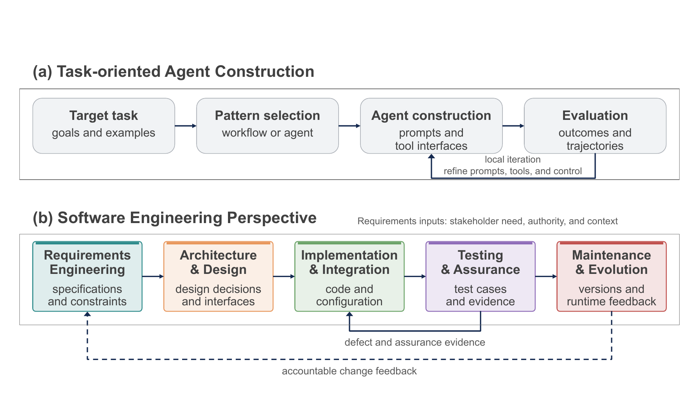

# Software Engineering for LLM-Based Agents: A Lifecycle-Oriented Survey

Yifei Ge, Yalin Feng, Weisong Sun, Junjie Shi, Zhenpeng Chen, Chunrong Fang, Zhihong Zhao, Zhenyu Chen, Yang Liu, and Zhi Jin

[Read the current manuscript](paper/survey.pdf) · [Browse the classified literature](papers/README.md) · [Bibliography](bibliography/discussed-studies.bib) · [中文导航](#中文导航)

## Overview

This survey examines how LLM-based Agent systems are engineered as software: how their requirements are established, architectures are designed, implementations are integrated, behavior is tested and assured, and deployed systems are maintained and evolved.

Our focus is the development of the Agent system itself. Research on using Agents to carry out external tasks, including software-engineering tasks, provides a different research context.



## Literature by Lifecycle Stage

The reading guide follows the current manuscript's subsections and nine engineering-comparison tables. It includes **146 distinct studies** from the main-analysis and supplementary discussions across the five lifecycle stages. Studies may appear in multiple stages; the counts below are reading-guide entries, not a new corpus census. Foundational SE references are listed separately.

| Lifecycle stage | 中文 | Discussed studies |
|---|---|---:|
| [Requirements Engineering](papers/requirements-engineering.md) | 需求工程 | 16 |
| [Architecture and Design](papers/architecture-and-design.md) | 架构与设计 | 39 |
| [Implementation and Integration](papers/implementation-and-integration.md) | 实现与集成 | 45 |
| [Testing and Assurance](papers/testing-and-assurance.md) | 测试与保障 | 32 |
| [Maintenance and Evolution](papers/maintenance-and-evolution.md) | 维护与演化 | 32 |

Each stage page connects **engineering problems → approaches → key ideas → representative papers**, followed by full paper titles, years, publication information, and links.

## Manuscript

- **[Current PDF](paper/survey.pdf)**: named-author draft compiled from the current manuscript source; [version information](paper/README.md).
- **[Discussed-study bibliography](bibliography/discussed-studies.bib)**: references associated with this reading guide.

This repository hosts the manuscript and curated literature resources. Paper links point to publishers, repositories, or author pages; third-party full-text PDFs are not redistributed here.

## Citation

To cite the current manuscript:

```bibtex
@unpublished{ge2026softwareengineeringagents,
  title  = {Software Engineering for {LLM}-Based Agents: A Lifecycle-Oriented Survey},
  author = {Ge, Yifei and Feng, Yalin and Sun, Weisong and Shi, Junjie and
            Chen, Zhenpeng and Fang, Chunrong and Zhao, Zhihong and
            Chen, Zhenyu and Liu, Yang and Jin, Zhi},
  year   = {2026},
  note   = {Unpublished manuscript},
  url    = {https://github.com/goufei123/SE-for-LLM-Agents-Survey}
}
```

## Updates

- **2026-11-10:** Initial private companion repository with the current manuscript, five lifecycle reading guides, and nine comparison tables.

## Suggesting a Paper

Please open an issue with the paper title, publication link, relevant lifecycle stage, and a short explanation of its contribution to engineering Agent systems. See [CONTRIBUTING.md](CONTRIBUTING.md).

## 中文导航

本仓库作为综述的论文与文献阅读入口，按当前正文的五个软件生命周期阶段及细分主题整理。每个阶段包含工程问题、方法思路和对应论文；分类沿用当前稿件，不包含检索脚本或内部审核记录。

可从上表进入需求工程、架构与设计、实现与集成、测试与保障、维护与演化，也可直接阅读[当前论文 PDF](paper/survey.pdf)。
